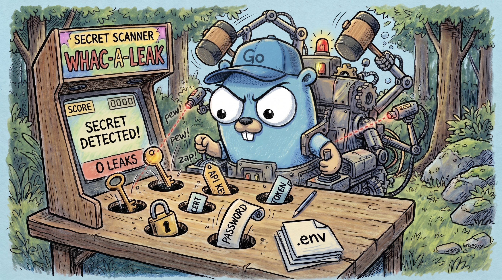

<p align="center"></p>

# Whac-a-Leak (`whac`)

Whac-a-Leak is a pure-Go secret scanner. CUE defines its rules. Each rule has a type, organization layers and its own samples. If a sample fails, whac does not load the rules.

The scan is plain Go. An Aho-Corasick keyword pass runs first. Only the rules with a keyword hit run their regex and charset-aware entropy checks, on the lines around the keyword. whac reads YAML, JSON, `.env`, properties, INI and HCL files as key paths. Allowlists use `whac1:` fingerprints, which do not change on a rebase.

> **Pre-alpha.** There is no tagged release yet. The [ADRs](.okfw/decisions/) record the design. [PLAN.md](PLAN.md) lists the milestones.

## Features

- 32 builtin rules. They cover cloud providers, code hosts, SaaS APIs, package registries, Vault, private keys, JWTs and passwords in URLs. See [Default Rules](https://infrashift.github.io/whac-a-leak/docs/reference/default-rules/).
- Organization layers in `.whac/*.cue`: add, tighten, disable or re-grade rules without a fork.
- Scan a directory, the staged changes (pre-commit) or the git history.
- Audit an AI agent's context before it starts: environment variables, credential files and credential sockets (`--agent-context`).
- Text, JSON and SARIF 2.1.0 output. whac redacts secrets by default.
- About 180 MB/s on one core. Fully offline.

## Quick start

```sh
make build                       # → bin/whac (Go 1.25+, CGO_ENABLED=0)
bin/whac scan .                  # scan the work tree; exit 1 on findings
bin/whac scan --staged           # pre-commit: scan only the lines you add
bin/whac scan --git              # scan every commit in the history
bin/whac scan --format sarif .   # SARIF for GitHub code scanning
bin/whac scan --agent-context    # preflight: what can an agent reach?
bin/whac rules verify            # run the samples of every rule
```

For the pre-commit framework, use the hook `whac` from this repository.

## Documentation

- **Docs site:** https://infrashift.github.io/whac-a-leak/
- **Contributing:** read [CLAUDE.md](CLAUDE.md) and the project wiki in [`.okfw/`](.okfw/). The wiki uses [OKF](https://github.com/infrashift/okf-wiki). Agents read it through `okfw mcp`.
